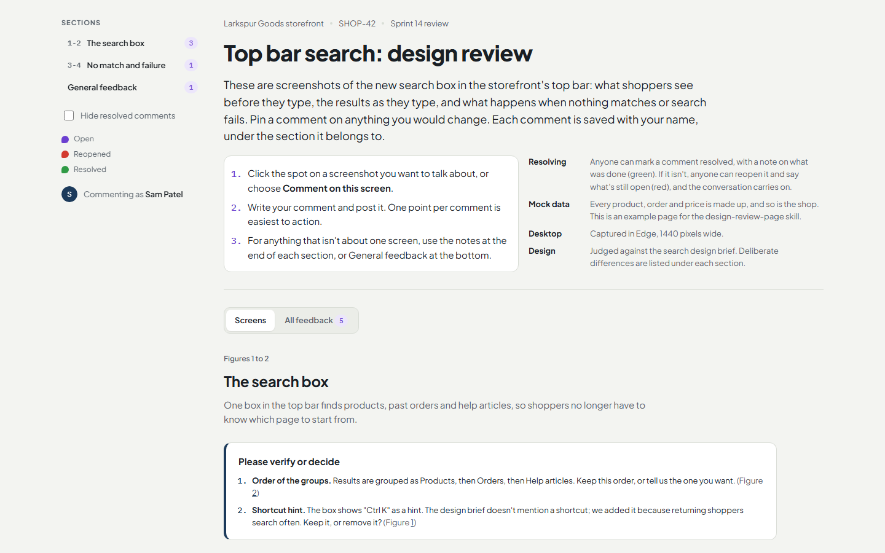
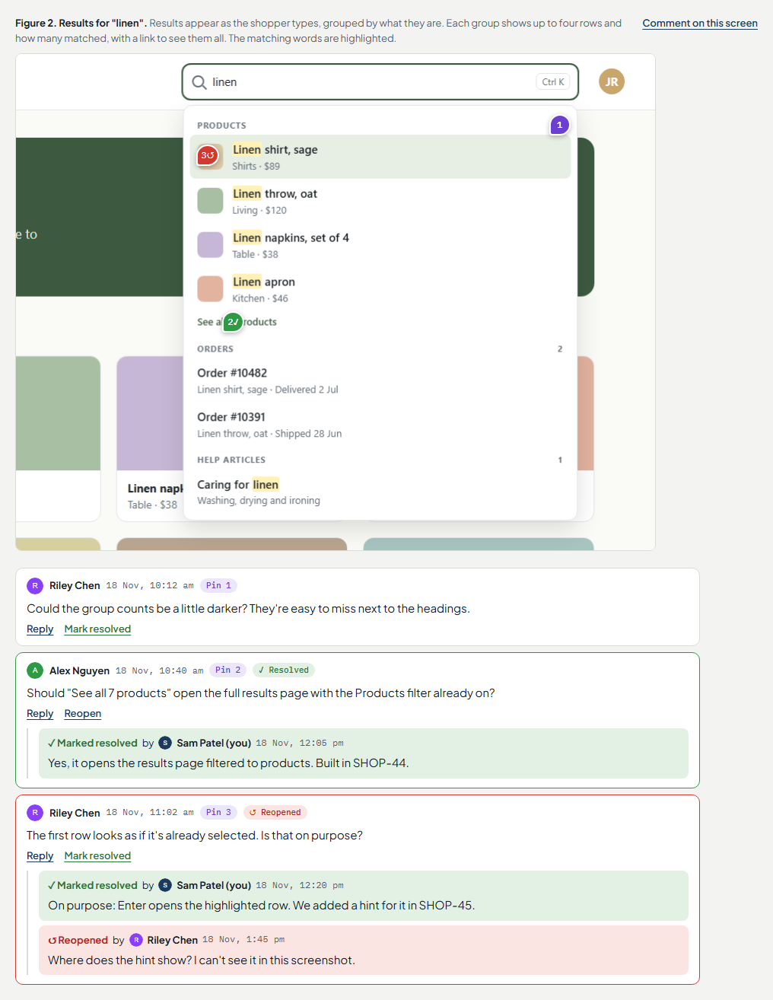
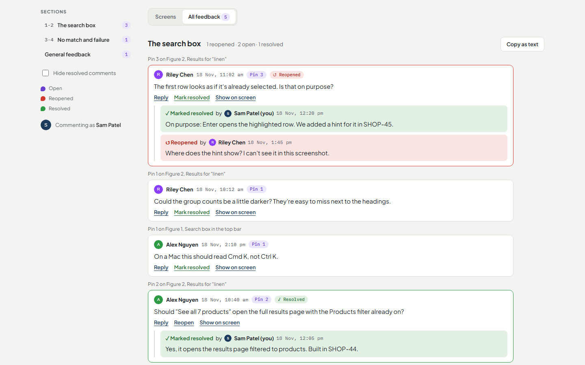

# design-review-page

A [Claude Code](https://claude.com/claude-code) skill that turns a frontend change into a review page that product owners, designers and other stakeholders can comment on, without ever running the app.

Every new screen and state becomes a captioned screenshot on a Claude artifact. Reviewers click a spot on a screenshot to pin a comment, add notes per section, and mark comments resolved or reopen them. You get the feedback back grouped by section, ready to turn into fixes and tickets.



## What it does

- **Captures the real app** with the Playwright MCP: every new or changed screen, at rest and after the interactions that matter, plus loading, empty and failure states (forced in the browser when mock data never produces them). Area-of-focus red boxes, consistent clips, one viewport size.
- **Writes for people who won't run the app.** Captions say what the reader is looking at and why it matters, in the product's words, not the code's. Each section lists what was built differently from the design on purpose, and can open with a "Please verify or decide" card for the calls only the product owner can make.
- **Has its own comment system.** Pins on screenshots, notes per section, replies, "mark resolved" with a note, and "reopen" with a reason. Comments live in the artifact's own database, not in Claude's native artifact comments, so nobody gets an @Claude notification and the owner reads them in their own time. Names come from the viewer's claude.ai profile.
- **Reads the feedback back for you.** `/design-review-page feedback <url>` lists every comment by section (reopened first, then open), and proposes a fix, a reply or a resolution for each. Nothing is written to the page or your tracker until you say so.
- **Is tested before it ships.** A build script checks the content, and a mock flow test drives the comment system end to end in a browser against a local stand-in for the artifact runtime.





## Requirements

- **Claude Code** with the Artifact and ArtifactData tools, so pages can be published as claude.ai artifacts with the `db` and `user` capabilities.
- **Reviewers on claude.ai.** You share the page from its Share menu. Reviewers need **Contributor** access to comment; Viewers and Commenters can only read.
- **Node 18 or later** for the build, mock server and test scripts. They have no dependencies.
- **The Playwright MCP** to capture screens and run the mock test.
- Optional: the **Atlassian MCP** (or your tracker's equivalent) to post the page's link on each ticket.

## Install

Copy the skill folder into your personal skills folder:

```sh
git clone https://github.com/suiyangqiu/design-review-page.git
cp -r design-review-page/skills/design-review-page ~/.claude/skills/
```

On Windows PowerShell:

```powershell
git clone https://github.com/suiyangqiu/design-review-page.git
Copy-Item -Recurse design-review-page\skills\design-review-page $HOME\.claude\skills\
```

Or put it in a project's `.claude/skills/` folder to share it with that repo's team.

## Use

| Command | What it does |
|---|---|
| `/design-review-page <tickets, PR or branch>` | Build a new page: scope it, capture the screens, write `review.json`, build, test on the mock, publish. |
| `/design-review-page update <artifact url>` | Add or retake screens, edit the text, republish. Comments are backed up first and kept. |
| `/design-review-page feedback <artifact url>` | Read the comments, summarise them by section, and act on them with you. |

Claude also picks the skill up when you ask for "a review page for the PO", "screenshots the designers can comment on" and the like.

## Try the page locally

The repo has a made-up example (a shop called Larkspur Goods, with invented data) you can build and click through without Claude:

```sh
node skills/design-review-page/scripts/build-page.cjs examples/storefront-search/review.json --out build
node skills/design-review-page/scripts/serve-mock.cjs build --port 18765
```

Open http://127.0.0.1:18765/. The mock keeps comments in `sessionStorage`. To see the page as someone else, set `sessionStorage.mockme` to `u_reviewer`, `u_owner` or `u_viewer` in the browser console and reload; `sessionStorage.mockro = "1"` makes you read-only.

To run the full mock flow test, point the Playwright MCP's `browser_run_code_unsafe` at a copy of `skills/design-review-page/scripts/mock-flow-test.js` (set `BASE` to your port). It returns `pass: true` with 36 named checks.

## What's in the box

```
skills/design-review-page/
  SKILL.md                     the three modes, settings and hard rules
  assets/review-page.html      the page template: layout, comment system, All feedback view
  references/
    review-json.md             every review.json field, choosing sections, writing for reviewers
    capturing-screens.md       worktrees, the Playwright MCP, red boxes, forcing loading/empty/failure
    comments-data.md           the comment rows, reading feedback, backups and restores
  scripts/
    build-page.cjs             checks review.json and builds index.html
    serve-mock.cjs             serves a built page with a stand-in for the artifact runtime
    mock-claude.js             that stand-in: comments in sessionStorage, three made-up people
    mock-flow-test.js          drives the comment flows end to end
examples/storefront-search/    review.json and screenshots for the made-up example
```

## Defaults you may want to change

- **House style.** The build warns on en and em dashes, and the skill writes every PR as `[repo #N](link)`. Change these in `SKILL.md` (hard rule 9) and `build-page.cjs` if your team writes differently.
- **Ticket links.** Set `jiraBase` in `review.json` to the URL your ticket keys are appended to (`https://your-site.atlassian.net/browse/`). Without it, keys show as plain text.
- **Dates.** Comment times use each viewer's own locale, or `locale` in `review.json` (`en-US`, `en-AU`) to fix one.
- **Viewport.** Screens are captured at 1440x900 unless the change is about another size.

## License

[MIT](LICENSE)
